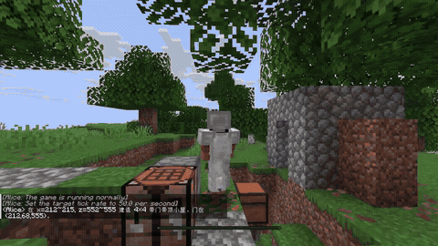
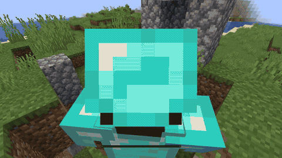
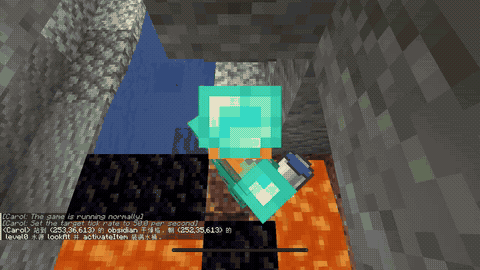
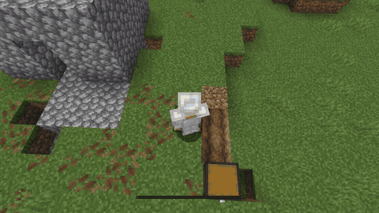
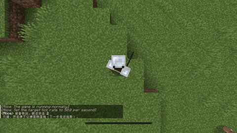
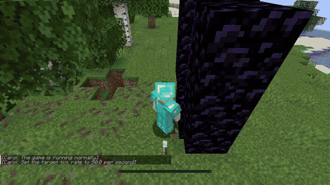
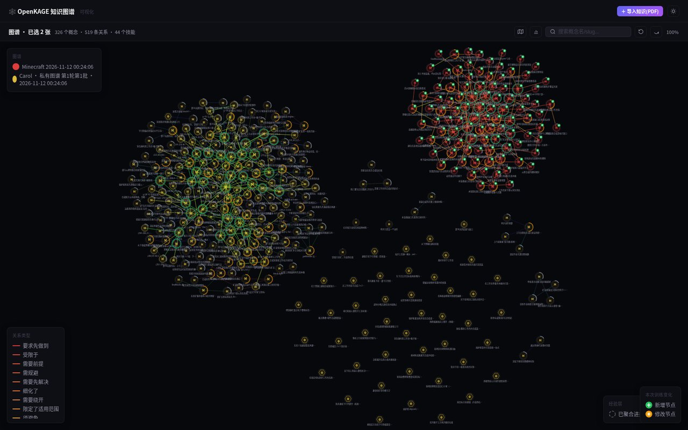
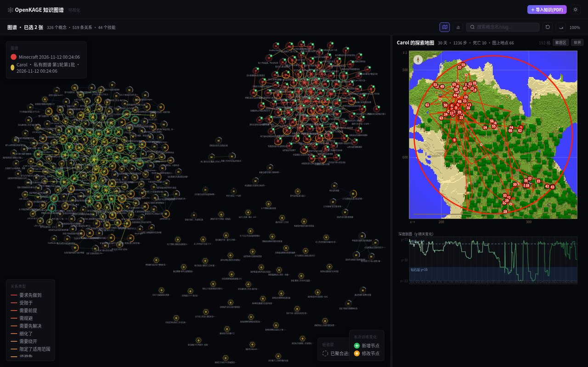
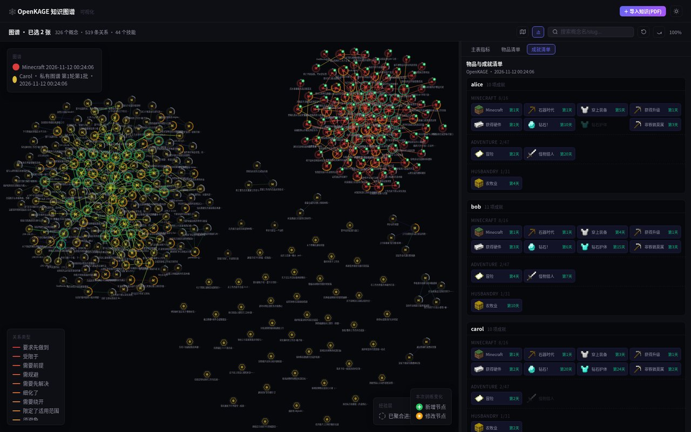
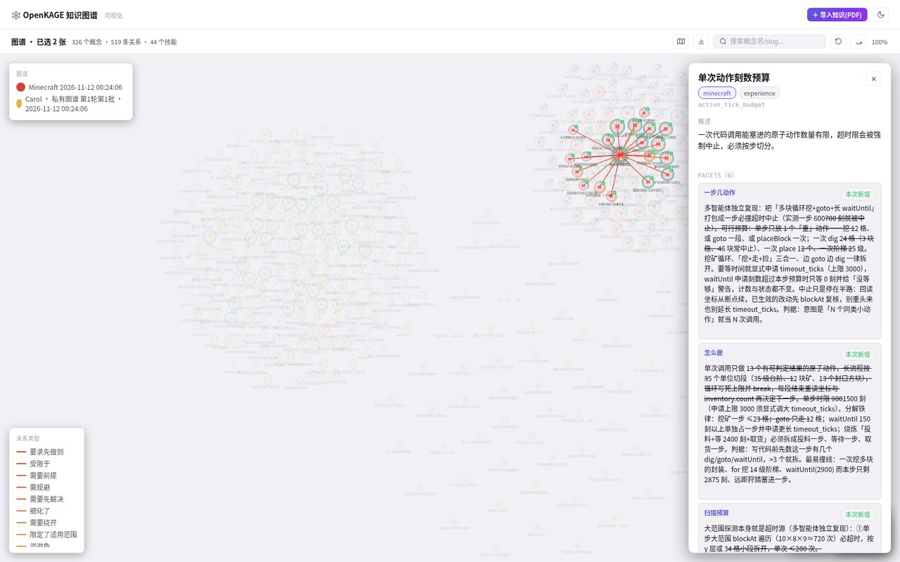

# OpenKAGE

**Open** **K**nowledge-sharing **A**gent-**G**roup **E**volution — a framework that drives lifelong learning and collective evolution of agents.

MIT · Python 3 · Minecraft 1.21.11 · ICLR 2027 anonymous submission

[简体中文](README.zh-CN.md)

OpenKAGE lets a group of LLM agents accumulate, share, and reuse knowledge while exploring an open world. Situated memories stay local; transferable experience and executable skills become a shared resource that the group consolidates, retrieves, and builds on over time.

## Behavior demos

OpenKAGE agents acquire situated memories and transferable experience in Minecraft, then reuse shared skills through intent-aware retrieval. The six clips below show representative behaviors: shelter construction, fishing, obsidian crafting, crop planting, hunting, and Nether portal entry.

| Shelter | Fishing | Obsidian crafting |
|---|---|---|
|  |  |  |
| Farming | Hunting | Nether portal |
|  |  |  |

## Quickstart

> [!NOTE]
> This repository does not bundle the experiment run records. Extract the separate anonymous archive so that its `results/` directory sits beside `openkage/`, `experiments/`, `viewer/`, and `paper/`.

```bash
python experiments/paper_metrics.py --cell ds_openkage --summary
python experiments/plot_paper_progress.py
python viewer/server.py                    # http://127.0.0.1:8090/
```

These commands need no LLM endpoint or Minecraft server. See [Installation](#installation) for dependencies.

## Key ideas

- **Two-layer knowledge graph.** A memory layer keeps situated, per-agent memories; an experience layer holds transferable experience and executable skills with their applicability conditions.
- **Shared knowledge with two rhythms.** Skills are shared verbatim every night; every `K = 2` game days, textual experience is consolidated into a continuously evolving shared graph.
- **Intent-aware retrieval.** Planning reads subgraphs from both local and shared graphs, so accumulated knowledge returns to decisions.
- **Runnable research stack.** The framework, two baselines, metric CLI, figure pipeline, and read-only viewer are all included.

## Viewer

The read-only viewer makes a run's knowledge state inspectable: shared and private graphs, exploration trajectories, achievements, and the facets and skills attached to a concept.

| Knowledge graph | Exploration map |
|---|---|
|  |  |
| Achievements | Node detail |
|  |  |

## What's in this repository

| Path | What it contains |
|---|---|
| `openkage/` | Planner, reflector, aggregator, two-layer graph, retrieval, skill maintenance, and rollout loop. |
| `domains/minecraft/` | Minecraft action API, Mineflayer bridge, observation collection, and metrics. |
| `agents/`, `prompts/`, `configs/` | Personas, prompts, and the authoritative run configuration. |
| `voyager/`, `echo/` | Re-implementations of the two external baselines. |
| `experiments/` | Run entry points, the metric CLI, and the figure pipeline. |
| `viewer/` | Read-only visualization web page. |
| `paper/iclr2027/` | Figure data and regenerated result figures. |
| `media/` | Behavior clips and viewer screenshots used in this README; see [media/README.md](media/README.md). |
| `results/` | **Not included.** Place the separately distributed run records here. |

## Installation

```bash
pip install openai python-dotenv pyyaml json-repair
pip install matplotlib Pillow fastapi uvicorn NBT
(cd domains/minecraft/mc_server && npm install)   # only for new runs
```

Figure regeneration also needs [Inkscape](https://inkscape.org/) on `PATH`. The Minecraft server and worker directories are not bundled; replace `/path/to/...` placeholders as described in [Running your own experiment](#run-your-own-experiment).

## Run your own experiment

```bash
cp .env.example .env
python experiments/run.py --help
python experiments/run.py --domain minecraft --arms 3 --max-nights 30 \
    --model deepseek-flash --mc-dir /your/mc/server --mc-workers-dir /your/workers
```

- `run.py` — OpenKAGE; add `--no-graph` for the planner-only control, or `--seed-graph <completed-run-dir>` for transfer.
- `run_ablation.py` — leave-one-out ablations and the Raw condition.
- `run_voyager.py`, `run_echo.py` — the two external baselines.
- `--mc-dir`, `--mc-workers-dir`, `--mc-port-base`, and `--mineflayer-port-base` point at a real Minecraft server, worker templates, and free ports. Runs on the same machine must use disjoint worker directories and port ranges. See [domains/minecraft/mc_server/README.md](domains/minecraft/mc_server/README.md).

## Reproducibility

| Goal | Command | Main input |
|---|---|---|
| Recompute anchor metrics | `python experiments/paper_metrics.py --cell ds_openkage --summary` | released checkpoints |
| Regenerate result figures | `python experiments/plot_paper_progress.py` | daily series, skill-usage data, checkpoints |
| Browse run state | `python viewer/server.py` | `results/` and per-day contexts |

<details>
<summary>Metric CLI options</summary>

```bash
python experiments/paper_metrics.py results/ds_openkage/run01
python experiments/paper_metrics.py results/abl_no_sharing/run0{1,2,3}
python experiments/paper_metrics.py --cell abl_raw_shared_pool --format latex
python experiments/paper_metrics.py --cell glm53_openkage --format json --all
```

The default table reports `Deaths`, `Repeat`, `XP/life`, `Tool era`, `Obsidian`, and `Nether`, plus `Weakest XP/life`, `Others' skills`, and `All-3 dmd.`. `--format` accepts `table`, `tsv`, `json`, and `latex`; `--summary` pools all input runs; `--all` adds diagnostic columns. Cell names follow the separate archive's `results/manifest.tsv`.

</details>

<details>
<summary>Figure inputs and outputs</summary>

| Input | Contents |
|---|---|
| `paper/iclr2027/tables/daily_series.json` | Per-run, per-agent, per-day series for the main-table cells. |
| `paper/iclr2027/tables/skill_usage_figdata.json` | Skill-call outcomes and code-revision windows for Figure 11(b,c). |
| `results/<cell>/runNN/checkpoint_<agent>_r*.json` | Raw checkpoints for Figures 6 and 12. |

`plot_paper_progress.py` writes six SVG/PDF pairs into [paper/iclr2027/fig/](paper/iclr2027/fig/): `fig_death_causes`, `fig_transfer`, `fig_runs`, `fig_death_rate`, `fig_knowledge`, and `fig_scaling`. Figures 1–4, 7, and 8 are schematic diagrams from the paper source, not outputs of this script.

</details>

<details>
<summary>Configuration</summary>

- [.env.example](.env.example) documents `OPENAI_API_KEY`, `OPENAI_BASE_URL`, optional `EMBEDDING_*` keys, and `OPENKAGE_RESULTS_DIR`.
- [configs/openkage_default.yml](configs/openkage_default.yml) is the authoritative parameter source; CLI flags override it.
- Embeddings are optional. Without `EMBEDDING_API_KEY`, retrieval uses graph structure only. The default `EMBEDDING_DIM` is 896; set it to the provider's actual dimension when using a public service.

</details>

## Notes

- This is an anonymous public repository for a double-blind review: author names, affiliations, host names, account names, internal paths, and credentials were removed.
- The `results/` directory is intentionally absent; run records are distributed separately. World saves and vector-index sidecars are not included.
- The code talks to a single OpenAI-compatible endpoint, so model ids and sampling behaviour depend on the configured provider.
- There is no `requirements.txt`; [Installation](#installation) lists dependencies by purpose. The viewer frontend source is in [viewer/frontend/src](viewer/frontend/src).

## License and citation

Released under the [MIT License](LICENSE) with an anonymous copyright holder during the review period. Citation details will be provided after the review period.
