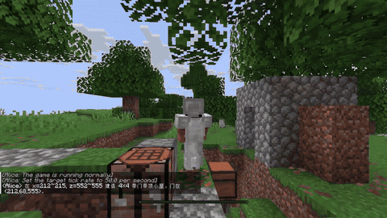
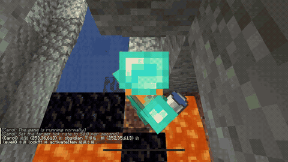
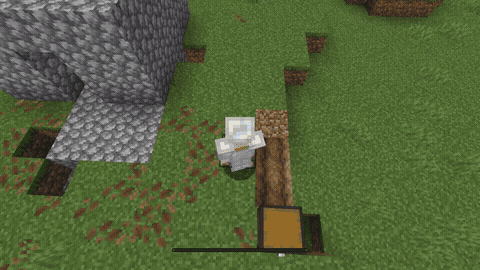
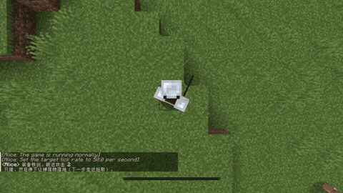
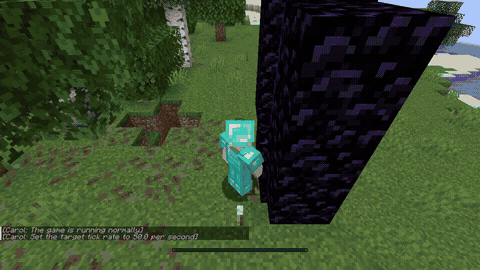
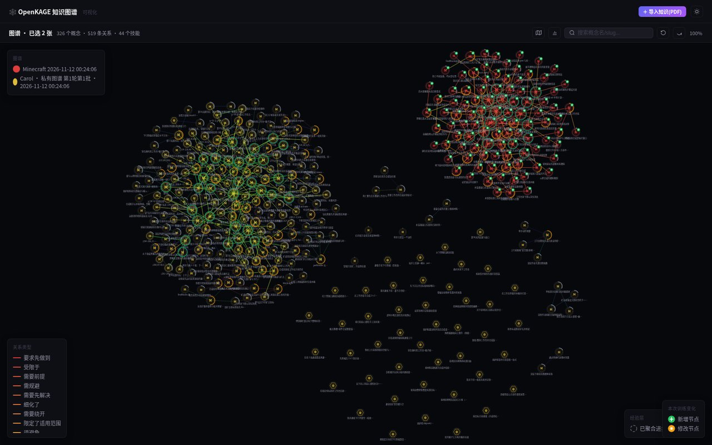
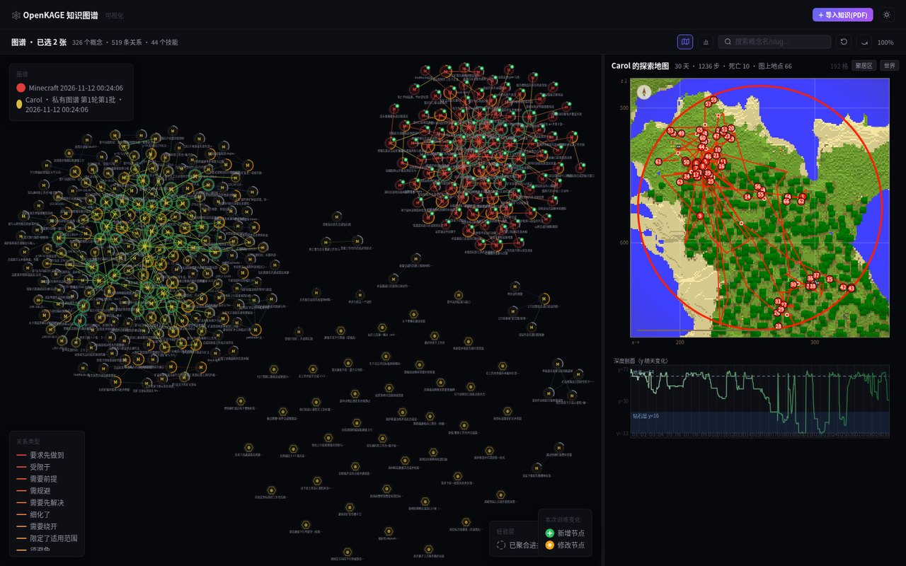
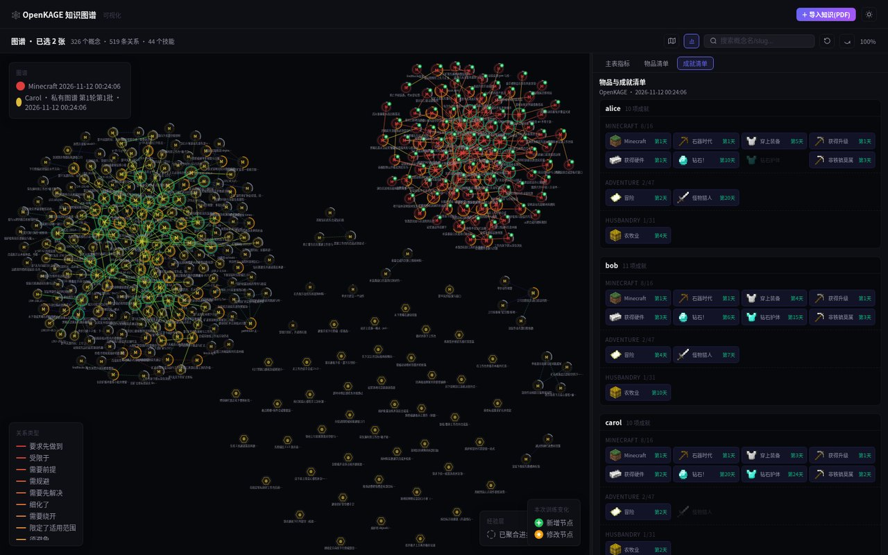
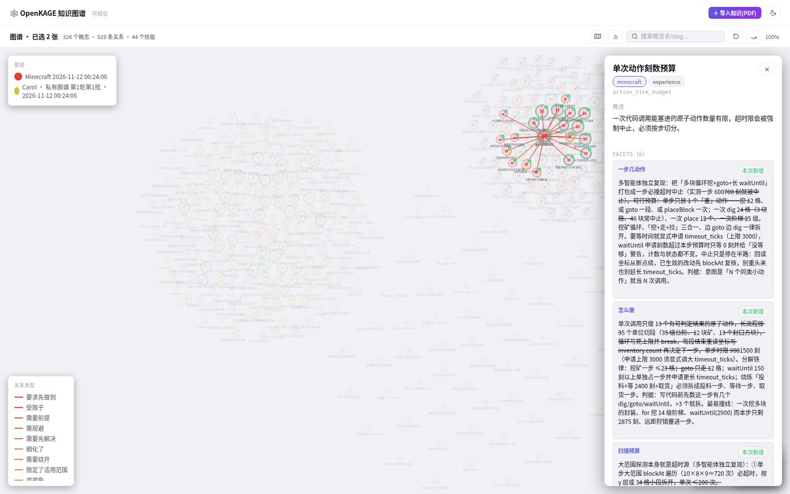

# OpenKAGE

**Open** **K**nowledge-sharing **A**gent-**G**roup **E**volution —— 一个驱动智能体终身学习和群体进化的框架。

MIT · Python 3 · Minecraft 1.21.11 · ICLR 2027 匿名投稿

[English](README.md)

OpenKAGE 让一组 LLM 智能体在开放世界探索中持续积累、共享并复用知识：情境记忆留在本地，可迁移经验与可执行技能进入共享层，由群体持续整合、检索并用于后续决策。

## 行为演示

OpenKAGE 智能体在 Minecraft 中积累情境记忆与可迁移经验，并通过意图感知检索复用群体共享的技能。下面六段展示代表性行为：建庇护所、钓鱼、制黑曜石、播种、捕猎与搭建下界传送门。

| 建庇护所 | 钓鱼 | 制黑曜石 |
|---|---|---|
|  |  |  |
| 播种 | 捕猎 | 下界传送门 |
|  |  |  |

## 快速开始

> [!NOTE]
> 本仓库不附带实验运行记录。请先解包单独发布的匿名归档，使 `results/` 与 `openkage/`、`experiments/`、`viewer/`、`paper/` 同级。

```bash
python experiments/paper_metrics.py --cell ds_openkage --summary
python experiments/plot_paper_progress.py
python viewer/server.py                    # http://127.0.0.1:8090/
```

这些命令不需要 LLM 端点或 Minecraft 服务器。依赖见[安装](#安装)。

## 核心思路

- **双层知识图。** 记忆层保存与情境绑定的个体记忆；经验层保存可迁移经验和可执行技能，并保留适用条件。
- **两种节奏的共享。** 技能每晚原样共享；每 `K = 2` 个游戏日，文本经验被整合进持续演进的共享图。
- **意图感知检索。** 规划时同时读取本地图与共享图的子图，让积累的知识重新进入决策。
- **完整可运行的研究栈。** 框架本体、两个基线、指标 CLI、绘图管线与只读可视化网页都在仓库内。

## 可视化界面

只读可视化界面用于查看一次运行中的知识状态：共享/私有图谱、探索轨迹、成就进展，以及概念或技能节点上的条件、经验与技能细节。

| 知识图谱 | 探索地图 |
|---|---|
|  |  |
| 成就清单 | 节点详情 |
|  |  |

## 仓库内容

| 路径 | 内容 |
|---|---|
| `openkage/` | planner、reflector、aggregator、双层图、检索、技能维护与 rollout 主循环。 |
| `domains/minecraft/` | Minecraft 动作 API、Mineflayer 桥接、观测采集与指标。 |
| `agents/`、`prompts/`、`configs/` | 智能体人设、提示词与权威运行配置。 |
| `voyager/`、`echo/` | 两个外部基线的复现实现。 |
| `experiments/` | 运行入口、指标 CLI 与绘图管线。 |
| `viewer/` | 只读可视化网页。 |
| `paper/iclr2027/` | 图数据与重绘结果图。 |
| `media/` | README 中使用的行为演示与界面截图；见 [media/README.md](media/README.md)。 |
| `results/` | **不在本仓库内。** 单独发布的运行记录解包到这里。 |

## 安装

```bash
pip install openai python-dotenv pyyaml json-repair
pip install matplotlib Pillow fastapi uvicorn NBT
(cd domains/minecraft/mc_server && npm install)   # 仅跑新实验需要
```

重绘结果图还需要系统 `PATH` 上有 [Inkscape](https://inkscape.org/)。Minecraft 服务端与 worker 目录不在仓库内；命令行默认值里的 `/path/to/...` 均为占位符，详见[自己跑实验](#自己跑实验)。

## 自己跑实验

```bash
cp .env.example .env
python experiments/run.py --help
python experiments/run.py --domain minecraft --arms 3 --max-nights 30 \
    --model deepseek-flash --mc-dir /your/mc/server --mc-workers-dir /your/workers
```

- `run.py` —— OpenKAGE；加 `--no-graph` 跑 planner-only 控制组，加 `--seed-graph <已完赛run目录>` 做迁移。
- `run_ablation.py` —— 留一消融与 Raw 条件。
- `run_voyager.py`、`run_echo.py` —— 两个外部基线。
- `--mc-dir`、`--mc-workers-dir`、`--mc-port-base`、`--mineflayer-port-base` 分别指向真实服务端、worker 模板与空闲端口；同机并行 run 必须错开 worker 目录和端口段。详见 [domains/minecraft/mc_server/README.md](domains/minecraft/mc_server/README.md)。

## 复现

| 目标 | 命令 | 主要输入 |
|---|---|---|
| 复算锚点指标 | `python experiments/paper_metrics.py --cell ds_openkage --summary` | 已发布 checkpoint |
| 重绘结果图 | `python experiments/plot_paper_progress.py` | 逐日序列、技能使用数据、checkpoint |
| 浏览运行状态 | `python viewer/server.py` | `results/` 与逐日 context |

<details>
<summary>指标 CLI 选项</summary>

```bash
python experiments/paper_metrics.py results/ds_openkage/run01
python experiments/paper_metrics.py results/abl_no_sharing/run0{1,2,3}
python experiments/paper_metrics.py --cell abl_raw_shared_pool --format latex
python experiments/paper_metrics.py --cell glm53_openkage --format json --all
```

默认表输出 `Deaths`、`Repeat`、`XP/life`、`Tool era`、`Obsidian`、`Nether`，外加 `Weakest XP/life`、`Others' skills`、`All-3 dmd.`。`--format` 可取 `table` / `tsv` / `json` / `latex`；`--summary` 汇总所有输入 run；`--all` 追加诊断列。实验格名见单独归档中的 `results/manifest.tsv`。

</details>

<details>
<summary>图输入与输出</summary>

| 输入 | 内容 |
|---|---|
| `paper/iclr2027/tables/daily_series.json` | 主表实验格逐 run、逐智能体、逐天的序列。 |
| `paper/iclr2027/tables/skill_usage_figdata.json` | Figure 11(b,c) 用的技能调用结果与改码前后窗口数据。 |
| `results/<cell>/runNN/checkpoint_<agent>_r*.json` | Figure 6 / 12 使用的原始 checkpoint。 |

`plot_paper_progress.py` 向 [paper/iclr2027/fig/](paper/iclr2027/fig/) 写出六对 SVG/PDF：`fig_death_causes`、`fig_transfer`、`fig_runs`、`fig_death_rate`、`fig_knowledge`、`fig_scaling`。论文 Figure 1–4、7、8 是论文源码里的示意图，不由本脚本生成。

</details>

<details>
<summary>配置</summary>

- [.env.example](.env.example) 说明 `OPENAI_API_KEY`、`OPENAI_BASE_URL`、可选的 `EMBEDDING_*` 与 `OPENKAGE_RESULTS_DIR`。
- [configs/openkage_default.yml](configs/openkage_default.yml) 是权威参数源，命令行 flag 仅做覆盖。
- Embedding 可选。不设 `EMBEDDING_API_KEY` 时只走图结构检索。默认 `EMBEDDING_DIM` 为 896；使用公共服务时请改成实际维度。

</details>

## 说明

- 这是双盲评审期间的匿名公开仓库：作者姓名、单位、主机名、账号名、内部路径与凭据均已移除。
- `results/` 目录有意不放入本仓库；运行记录单独发布，世界存档与向量索引附属文件不在其中。
- 代码只对接一个 OpenAI 兼容端点，因此模型 id 与采样行为取决于配置的服务商。
- 仓库内没有 `requirements.txt`，[安装](#安装)按用途列出依赖。可视化网页前端源码位于 [viewer/frontend/src](viewer/frontend/src)。

## 许可证与引用

评审期以匿名版权人按 [MIT 许可证](LICENSE) 发布。引用信息将在评审期结束后提供。
